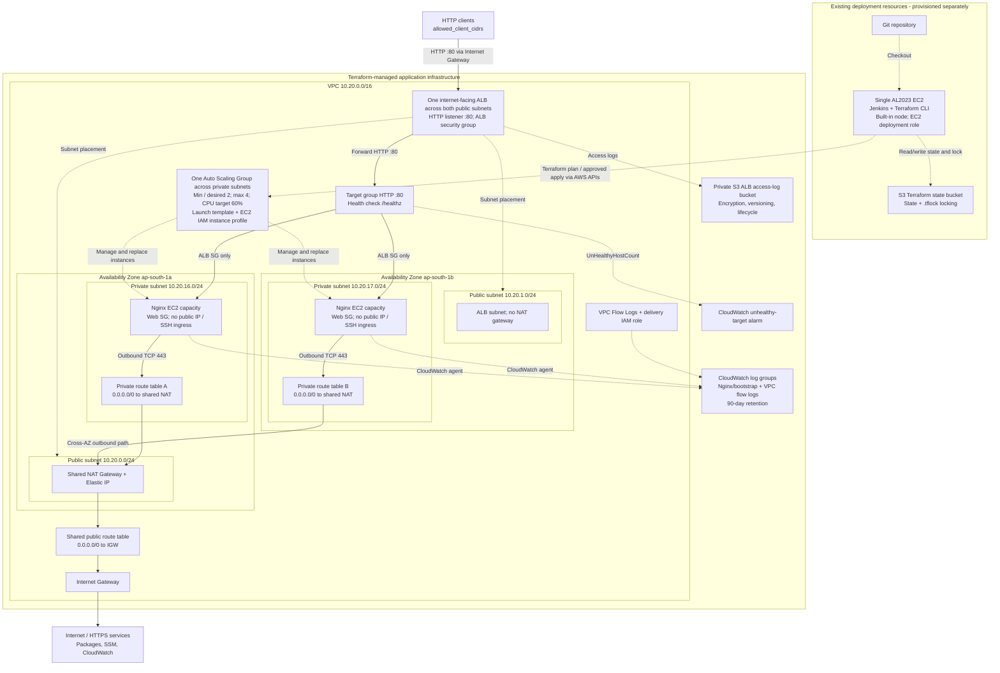

# TF-aws: production-oriented Nginx on AWS

Terraform provisions an internet-facing Application Load Balancer in public subnets and Nginx EC2 instances in private subnets across two Availability Zones. An Auto Scaling Group starts with two instances, replaces unhealthy hosts and scales on average CPU utilization. No infrastructure is deployed by adding these files.

## Architecture

The diagram shows the default two-AZ deployment in `ap-south-1`. Solid arrows show application traffic and outbound routes; dotted arrows show management, logging and deployment relationships.



The ALB spans both public subnets; the drawing places its shared listener above them for clarity. Jenkins manages all resources inside the Terraform-managed boundary; its arrow to the Auto Scaling Group represents deployment, not application traffic. The Jenkins EC2 network placement is configured separately and is not defined by this Terraform code.

CIDRs, AZs and capacity values above are defaults. The configuration accepts two or three AZs and creates one public subnet, private subnet and private route table per AZ, with a single shared NAT gateway in the first configured AZ. The ASG manages total capacity across the private subnets; the instance boxes do not represent a fixed instance count per AZ. Application EC2 instances accept HTTP only from the ALB security group and use the shared NAT gateway for outbound HTTPS. Outbound access from all private subnets depends on its AZ; traffic from other AZs can incur cross-AZ transfer charges. The alarm sends notifications only when `alarm_topic_arns` is populated.

## Structure

```text
environments/production/       Deployable root, inputs, backend examples, tests
modules/
  vpc/                        VPC, DNS support, empty default security group
  subnet/                     Reusable public/private subnet, no auto public IPs
  internet_gateway/           VPC Internet gateway
  nat_gateway/                One shared NAT gateway and Elastic IP in the first AZ
  route_table/                Route table, default route and subnet associations
  security_groups/            ALB and EC2 security boundaries
  iam/                        EC2 role, scoped log access and SSM profile
  logging/                    Private ALB log bucket, Nginx logs and VPC flow logs
  load_balancer/              Public ALB, HTTP listener, targets, alarm
  ec2/                        Launch template, Nginx bootstrap, ASG and scaling
```

Every module declares its provider requirements and exposes inputs/outputs; provider configuration stays in the environment root. Add future environments as separate roots with independent backend keys and account restrictions.

## Prerequisites

- Install Terraform CLI **1.17.0**, Jenkins **2.580.1 LTS**, and Amazon Corretto **Java 21** using the Amazon Linux 2023 steps below (versions checked on October 24, 2026). The code accepts Terraform >= 1.11 and < 2; the AWS provider is pinned to **6.70.0** and is downloaded by `terraform init`. Commit the generated `.terraform.lock.hcl` to record provider checksums.
- AWS credentials from an assumed role, SSO or workload identity; never put credentials into Terraform files. The provider checks `aws_account_id` before deploying.
- Two supported AZs in the selected region, sufficient EC2/EIP/NAT quotas and an unused VPC CIDR. Default region is Mumbai (`ap-south-1`).
- An existing S3 state bucket, provisioned separately, with versioning, encryption, public access blocked and least-privilege access. Backend credentials need bucket listing and state object read/write; the `.tflock` object also needs read/write/delete. For KMS encryption, grant the backend role the required key permissions.

## Amazon Linux 2023: install Jenkins and Terraform

Use one existing AL2023 EC2 instance for Jenkins and Terraform. Provision it separately from this application stack. Jenkins runs every pipeline command on its built-in node as the `jenkins` user. The application Nginx instances do not need Jenkins or Terraform.

Run all commands below in **Bash on the same AL2023 EC2 instance**, as `ec2-user` with sudo access. Allow outbound HTTPS to Git, Terraform downloads, AWS APIs and the S3 backend. Allow inbound TCP 8080 only from your administrator IP/VPN. Attach the deployment IAM role described in the Jenkins section to this EC2 instance.

### 1. Install Java and Jenkins

```bash
sudo dnf install -y java-21-amazon-corretto-headless fontconfig git wget
java -version

sudo wget -O /etc/yum.repos.d/jenkins.repo https://pkg.jenkins.io/rpm-stable/jenkins.repo
sudo rpm --import https://pkg.jenkins.io/rpm-stable/jenkins.io-2026.key
sudo dnf install -y jenkins-2.580.1
sudo systemctl daemon-reload
sudo systemctl enable --now jenkins
sudo systemctl status jenkins --no-pager
rpm -q jenkins

# Use this password only to unlock the initial setup wizard.
sudo cat /var/lib/jenkins/secrets/initialAdminPassword
```

Open `http://<controller-address>:8080`, unlock Jenkins, install suggested plugins and create your administrator account. Ensure **Pipeline**, **Git**, and **Credentials Binding** are installed under **Manage Jenkins > Plugins**. Under **Manage Jenkins > Nodes > Built-In Node > Configure**, set the number of executors to **1**, set **Labels** to `built-in`, and set **Usage** to **Only build jobs with label expressions matching this node**. The Jenkinsfile targets `built-in`, so commands run on this EC2 instance.

### 2. Install Terraform on the same EC2 instance

```bash
sudo dnf install -y java-21-amazon-corretto-headless git unzip curl
java -version

# Run this whole block in the same Bash session. Supports x86_64 and Graviton.
(
  set -euo pipefail
  TF_VERSION=1.17.0
  case "$(uname -m)" in
    x86_64) TF_ARCH=amd64 ;;
    aarch64) TF_ARCH=arm64 ;;
    *) echo 'Unsupported CPU architecture'; exit 1 ;;
  esac
  TF_DOWNLOAD_DIR=$(mktemp -d)
  cd "$TF_DOWNLOAD_DIR"
  TF_ZIP="terraform_${TF_VERSION}_linux_${TF_ARCH}.zip"
  curl -fSLO "https://releases.hashicorp.com/terraform/${TF_VERSION}/${TF_ZIP}"
  curl -fSLO "https://releases.hashicorp.com/terraform/${TF_VERSION}/terraform_${TF_VERSION}_SHA256SUMS"
  grep " ${TF_ZIP}$" "terraform_${TF_VERSION}_SHA256SUMS" > terraform-checksum.txt
  sha256sum -c terraform-checksum.txt
  unzip "$TF_ZIP"
  sudo install -m 0755 terraform /usr/local/bin/terraform
)
terraform version
git --version

sudo -u jenkins /usr/local/bin/terraform version
```

Terraform should report **v1.17.0**. Java should report **21**. The Jenkins RPM already creates the `jenkins` user. Pipeline commands run as that user without sudo.

Make `/usr/local/bin` available to the Jenkins service, then restart it:

```bash
sudo mkdir -p /etc/systemd/system/jenkins.service.d
sudo tee /etc/systemd/system/jenkins.service.d/path.conf > /dev/null <<'EOF'
[Service]
Environment="PATH=/usr/local/bin:/usr/bin:/bin"
EOF
sudo systemctl daemon-reload
sudo systemctl restart jenkins
sudo systemctl status jenkins --no-pager
```

### 3. Configure the Jenkins pipeline

Follow the **Jenkins pipeline** section below to configure the two secret files, deployment permissions, approvers and multibranch job. Jenkins runs formatting checks, validation, mocked tests, production planning and approved applies on this EC2 instance. No workstation testing is required.
Installation references: [Jenkins Linux installation](https://www.jenkins.io/doc/book/installing/linux/), [Jenkins LTS releases](https://www.jenkins.io/changelog-stable/), [Jenkins Java support](https://www.jenkins.io/doc/book/platform-information/support-policy-java/), and [Terraform 1.17.0 binaries](https://releases.hashicorp.com/terraform/1.17.0/).

## Configure production inputs and deploy through Jenkins

Prepare two configuration files from the examples in `environments/production` and upload them as Jenkins **Secret file** credentials using the IDs in the Jenkins section below:

- `backend.hcl.example`: replace the state bucket, key and region placeholders with your existing S3 backend details.
- `terraform.tfvars.example`: replace account, AZ and other placeholders; use an approved Amazon Linux 2023 x86_64 AMI for the deployment region.

Keep completed files outside the Jenkins-managed workspace, which is deleted after builds. Do not commit completed configuration files, plans or state to Git.

Run a **PLAN** build on `main` to review the proposed infrastructure. Run an **APPLY** build to create a fresh plan, review it and approve that exact saved plan in Jenkins. All Terraform commands execute on the AL2023 Jenkins EC2 instance.

After apply, find the `alb_url` value in the Jenkins console output. Open that HTTP URL in your browser; `/healthz` should return `healthy`, and `/` should display the Nginx page. No hosted zone, custom domain or certificate is required. This stack uses HTTP port 80 without encryption.

Check healthy targets in the AWS target group console and instance distribution across AZs. Use AWS Systems Manager Session Manager to inspect application EC2 instances; there is no key pair, public instance IP or SSH ingress. The operator needs separate Session Manager permissions. Automated Terraform tests check configuration; these deployment checks verify the running service.
## Jenkins pipeline

The root `Jenkinsfile` runs checkout, formatting, initialization without a backend, validation and mocked Terraform tests on each branch. On `main`, it also initializes the S3 backend and creates a production plan. `ACTION=PLAN` is the default. Select `ACTION=APPLY` to generate a new plan and then request approval; the pipeline applies that exact saved plan only when changes exist. Approval expires after 20 minutes. There is no destroy action.

Configure Jenkins as follows:

1. Create a **Multibranch Pipeline** for this repository with script path `Jenkinsfile`. The production branch name is `main`. Other branches run validation/tests only.
2. Use the Jenkins **built-in node** on the same AL2023 EC2 instance, with **1 executor**, label `built-in`, Git, Java 21 and Terraform **1.17.0** on `PATH`, running Jenkins **2.580.1 LTS** as described above. Allow outbound access to Terraform provider downloads, AWS APIs and the S3 backend. Install Jenkins Pipeline, Git and Credentials Binding plugins on the controller.
3. Give this Jenkins EC2 instance an AWS deployment role through an EC2 instance profile or workload identity. Terraform uses the standard AWS credential chain; no AWS access keys are embedded in the pipeline. The role needs state/lock access plus permissions to manage the resources in these modules, including IAM role creation and `iam:PassRole`. Scope permissions to your deployment account and naming conventions.
4. Add two Jenkins **Secret file** credentials, scoped to this trusted deployment job/folder:

   | Credential ID | File content |
   | --- | --- |
   | `terraform-production-backend` | Completed `backend.hcl.example`, pointing to the existing state bucket/key |
   | `terraform-production-tfvars` | Completed `terraform.tfvars.example`, with the account, approved AMI and other production inputs |

5. Create the Jenkins authorization group `terraform-production-approvers`, or change `PRODUCTION_APPROVERS` in the Jenkinsfile to your permitted Jenkins user IDs/group names. Jenkins administrators can also approve input steps. Restrict job configuration, replay and repository write permissions to trusted operators.
6. The pipeline runs `terraform init -backend=false` before validation and tests. The root configuration pins AWS provider **6.70.0**. To record provider checksums in Git, perform a one-time `terraform -chdir=environments/production init -backend=false` in a separate checkout on this AL2023 instance and commit the generated lock file. This is setup only; routine tests and deployments run through Jenkins. To adopt a newer provider, update the root version constraint, regenerate and commit the lock file, and review a Jenkins PLAN build.
7. Run a `PLAN` build on `main` and review its console output. For deployment, run an `APPLY` build and have an authorized operator review and approve its plan.

Run only trusted repository code on this Jenkins instance: build commands share the controller host and its deployment role. Keep fork PR builds disabled for this job and restrict repository writes, job configuration and replay to trusted operators. The main-branch condition controls pipeline stages; it does not restrict the EC2 role to main-branch code.

Builds of this job queue rather than interrupt one another. S3 state locking also protects state operations across jobs; use a single production deployment job to avoid overlapping approval windows. Plan/apply failures fail the build and are not automatically retried. A stale saved plan is rejected by Terraform; rerun the pipeline to produce and approve a fresh plan. Build logs retain the Terraform plan output and should have restricted access. Secret files, binary plans and backend metadata are not archived; the workspace is deleted after every build.

The Jenkinsfile must be checked with your Jenkins controller's Declarative Pipeline linter before first use; Terraform validation does not validate Jenkins syntax or plugin availability. See [Jenkins Pipeline syntax](https://www.jenkins.io/doc/book/pipeline/syntax/) and [credentials binding](https://www.jenkins.io/doc/pipeline/steps/credentials-binding/) for controller configuration details.

## Operational choices

- A single NAT gateway in the first configured AZ serves all private subnets. Public routes point at the IGW; each private route points at the shared NAT. Bootstrap waits for the routes to exist. This reduces NAT gateway and Elastic IP counts but introduces a shared outbound dependency and potential cross-AZ transfer charges. An outage in the NAT AZ affects package installation, SSM and log delivery from all application instances.
- For an existing per-AZ NAT deployment, review a Jenkins PLAN build before applying: the first AZ's NAT gateway and Elastic IP keep their Terraform addresses, other AZs' NAT gateways and Elastic IPs are removed, and their private default routes switch to the retained NAT. Allow for temporary outbound interruption during the change. Keep the availability-zone list order stable.
- The internet-facing ALB listens on HTTP port 80 in the public subnets and forwards to private Nginx instances on port 80. EC2 accepts web traffic only from the ALB security group.
- EC2 uses IMDSv2, encrypted gp3 root disks and detailed monitoring. Nginx and the CloudWatch agent install through HTTPS repositories during bootstrap, with bounded retries and failure logging. Failed web health checks lead to ASG replacement after the grace period.
- `ami_id = null` discovers the latest matching AL2023 AMI and can cause a rollout on a subsequent plan. Pin an approved AMI for controlled releases. For reproducible deployments, bake Nginx and the agent into a tested AMI and replace package installation in user data with configuration only.
- Launch template updates trigger rolling instance refresh with automatic rollback. Allow EC2 quota for temporary surge capacity. Desired capacity is ignored after creation so Terraform does not undo autoscaling; use the ASG controls for manual capacity changes.
- ALB access logs go to a private, encrypted, versioned S3 bucket with 90-day expiration; Nginx/bootstrap and VPC flow logs go to CloudWatch with 90-day retention. ALB access logging uses SSE-S3. CloudWatch uses service encryption by default; add customer-managed KMS keys if your policy requires them.
- An unhealthy-target alarm is created. Populate `alarm_topic_arns` with existing SNS topics and confirmed subscriptions to receive notifications. CPU target tracking creates its own scaling alarms. Set additional latency, 5xx, capacity and billing alarms to your service SLOs.
- ALB deletion protection defaults to enabled. Logging buckets are not force-deleted. Teardown requires disabling protection in a reviewed apply and separately handling retained S3 object versions; normal destroy will fail for a nonempty bucket.
- AZ list order determines subnet CIDRs; reordering or changing the VPC CIDR can replace networking. Review plans carefully and preserve AZ ordering.

One NAT gateway, ALB, EC2, EBS, public IPv4, logs and data transfer incur ongoing charges. WAF, DNS records, certificate issuance, organization-level CloudTrail/GuardDuty, backups and workload-specific compliance controls are outside this stack. Review those needs before treating this baseline as production-ready for your service.

## Validation and tests in Jenkins

The **Format** stage runs Terraform formatting checks. The **Validate and test** stage initializes without the backend, validates the configuration and runs the mocked tests. Review the Jenkins console output for results. These stages execute on every branch; production planning and approved applies run on main.

Tests use a mocked AWS provider and do not create AWS resources. They check the two-AZ topology, one shared NAT gateway and per-AZ private route tables and rejection of single-AZ deployments and invalid client CIDRs. A real plan and post-deployment smoke tests remain necessary to verify account permissions, service quotas, AMI compatibility and runtime bootstrap.

References: [AWS provider ALB listeners](https://registry.terraform.io/providers/hashicorp/aws/latest/docs/resources/lb_listener), [S3 backend and lockfiles](https://developer.hashicorp.com/terraform/language/backend/s3).


